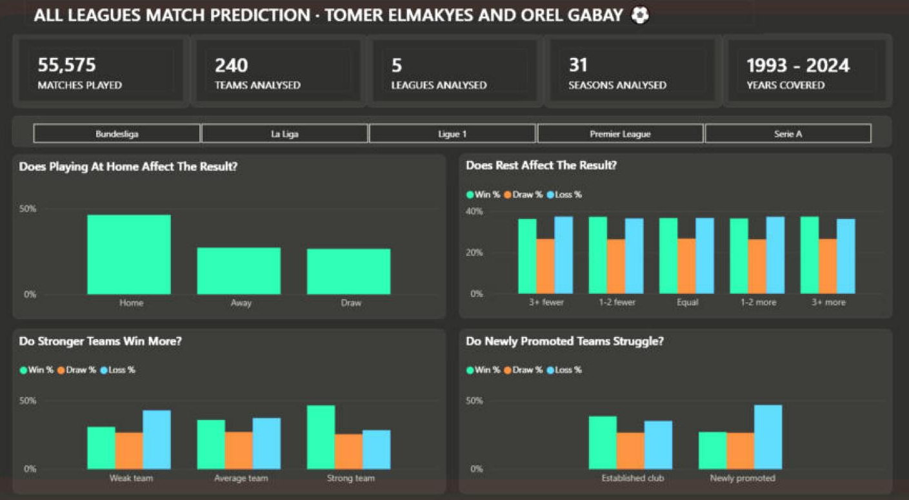

# ⚽ Before the Whistle – Football Match Outcome Analysis

**To what extent can the result of a football match be predicted from information known before kick-off?**

A Power BI analysis of **55,575 matches** from Europe's top 5 leagues across **31 seasons (1993/94 – 2023/24)**.
Team project by **Tomer Elmakyes & Orel Gabay** · final project of the Software Technician (MAHAT) program, ATID College, 2026.

## The data
| Matches | Teams | Leagues | Seasons |
|---|---|---|---|
| 55,575 | 240 | 5 (England, Spain, Italy, Germany, France) | 31 |

The raw data has only four fields per match: date, home team, away team and score.
**Every other variable was engineered from those four fields.**

## Pre-match factors we built
1. **Home vs. away** – does the host team have an advantage, and how big is it?
2. **Recent form** – points earned in the team's last five matches
3. **Rest & load** – days since the previous match
4. **League seniority** – was the team in the league last season, or newly promoted?

## Key findings
- 🏠 **Home advantage:** home teams win almost twice as often as away teams.
- 📈 **Form matters most:** teams in good form win **46%** of matches vs. **31%** in poor form.
- 🆕 **Promoted clubs struggle:** newly promoted teams lose **47%** of matches and win only **27%**.
- 😴 **Rest barely matters:** win rate stays within ~1 percentage point across all rest-difference levels.
- 🤝 **Draws are unpredictable:** about a quarter of matches end in a draw, and no factor predicted them.

## Tools
`Python` · `Pandas` · `Power BI` · `DAX` · `Power Query`

## Files
- `before_the_whistle_dashboard.pbix` – the Power BI report (open with Power BI Desktop)
- `dashboard.png` – dashboard screenshot

---
**Tomer Elmakyes** · Junior Data Analyst · [LinkedIn](https://www.linkedin.com/in/tomer-elmakyes-0824b8425/)
